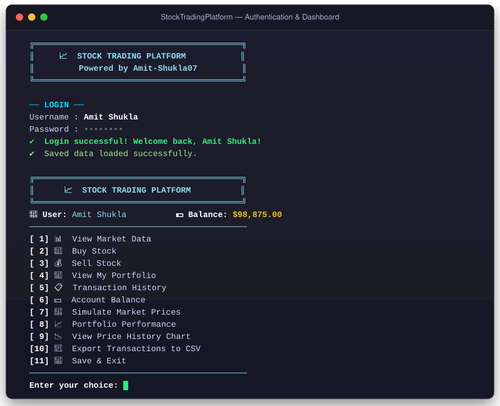
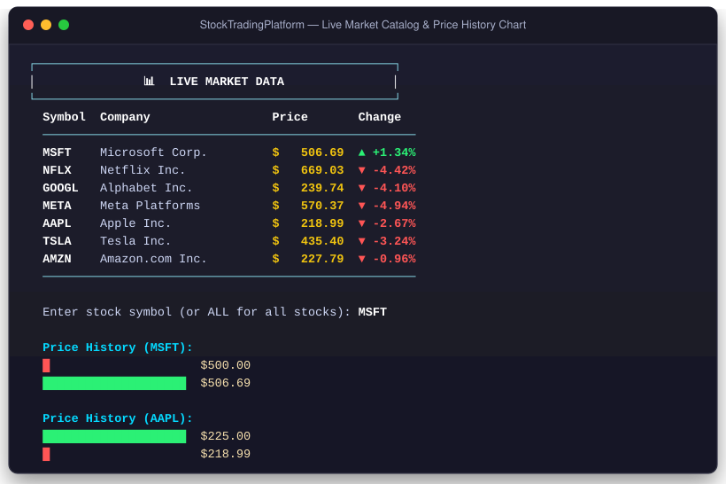
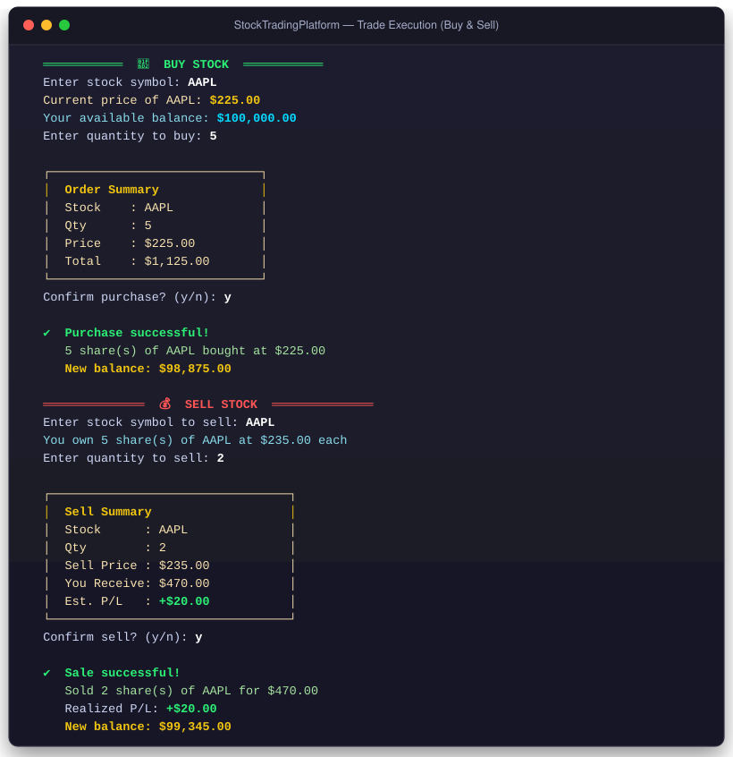
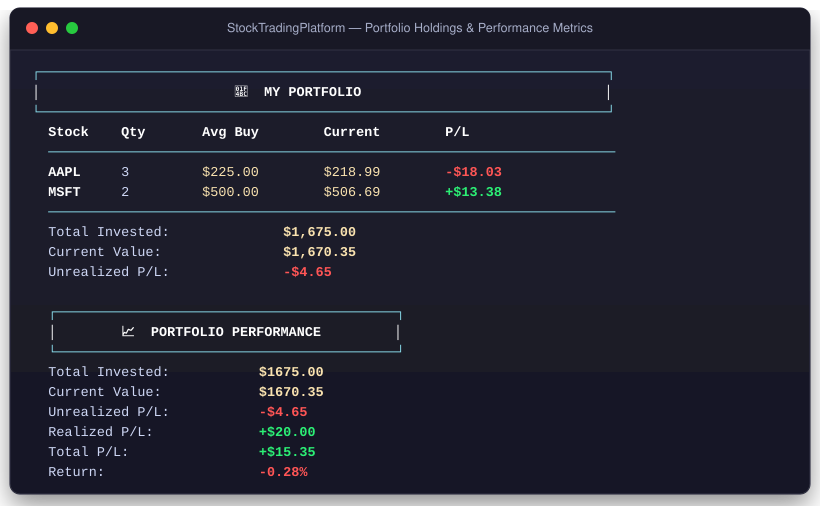
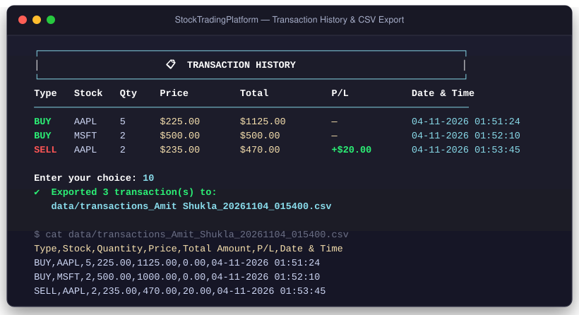

<p align="center">
  
  
  
  
</p>

<h1 align="center">📈 Stock Trading Platform</h1>

<p align="center">
  <i>A console-based stock trading simulator built with Core Java — buy/sell stocks, track your portfolio, analyze P&L, and simulate market prices.</i>
</p>

<p align="center">
  <a href="#-visual-walkthrough">Visuals</a> •
  <a href="#-features">Features</a> •
  <a href="#-how-it-works">How It Works</a> •
  <a href="#-architecture">Architecture</a> •
  <a href="#-project-structure">Structure</a> •
  <a href="#-getting-started">Getting Started</a> •
  <a href="#-tech-stack">Tech Stack</a>
</p>

---

## 📖 Overview

A terminal-based stock portfolio simulator written entirely in Core Java.  
Users register or log in, then interact with a simulated stock market — buying and selling shares, watching prices fluctuate, and tracking their portfolio performance and P&L over time.

All data is persisted to plain text files per user — **no database, no web server, no external dependencies required**.

> [!NOTE]
> This is an educational simulator. All prices are simulated locally. No real money, live quotes, or broker connectivity is involved.

---

## ✨ Features

| Feature | Description |
|:--------|:------------|
| 🔐 **Login / Register** | User authentication with file-based credential storage |
| 📊 **Live Market View** | Displays all 7 stocks with current price and % change indicator |
| 🛒 **Buy Shares** | Buy any stock when your balance covers the cost — with order confirmation |
| 💰 **Sell Shares** | Sell shares you own with a real-time P&L preview before confirming |
| 💼 **Portfolio Tracking** | Cash balance, share quantity, average buy price, and per-holding P&L |
| 📈 **Performance Dashboard** | Unrealized P&L, realized P&L, total return %, and current portfolio value |
| 📉 **ASCII Price Chart** | Rolling bar chart of the last 6 prices per stock (or all stocks) |
| 🔄 **Price Simulation** | Randomized ±10% price movement on demand |
| 📁 **CSV Export** | Exports full transaction history to a timestamped `.csv` file |
| 🎨 **Colored Output** | ANSI color coding — green for gains, red for losses, yellow for neutrals |
| 💾 **Persistent Storage** | Per-user `.txt` files save account, portfolio, and transaction history |
| 👥 **Multi-user Support** | Multiple accounts, each with independent save files |

---

## 📸 Visual Walkthrough

### 1. 🔐 User Authentication & Main Dashboard
Secure user login and account registration with session recovery and interactive dashboard menu.

<p align="center">
  
</p>

### 2. 📊 Live Market Data & ASCII Price History Chart
Real-time stock catalog with simulated price movements (▲ / ▼ percentage shifts) and interactive mini ASCII trend charts.

<p align="center">
  
</p>

### 3. 🛒 Order Execution with Guardrails & Validation
Buy and sell order processing featuring automated order summaries, balance checks, share ownership validation, real-time P/L estimation, and explicit confirmation prompts.

<p align="center">
  
</p>

### 4. 💼 Portfolio Tracking & Performance Metrics
Weighted average buy price computation, per-asset profit & loss color coding, and overarching performance metrics (Unrealized P/L, Realized P/L, Total Return %).

<p align="center">
  
</p>

### 5. 📋 Transaction History Ledger & CSV Export
Audit-ready transaction records with ANSI color highlights and one-click export to timestamped CSV files.

<p align="center">
  
</p>

---

## 🔍 How It Works

### Authentication
When the app starts, users either log in with an existing account or register a new one.  
Credentials are stored in `data/users.txt` as `username:hashedPassword` pairs.  
A fresh account starts with **$100,000.00** in simulated cash.

### Trading
The market ships with 7 sample stocks (AAPL, GOOGL, MSFT, AMZN, TSLA, META, NFLX).  
The user picks a stock, enters a quantity, reviews an order summary, and confirms.  
All validation (sufficient funds, sufficient shares, positive quantities) happens before any state changes.

### Persistence
Each user's data is saved to three files:
- `data/<username>_account.txt` — balance and realized P&L
- `data/<username>_portfolio.txt` — holdings (symbol, quantity, average buy price)
- `data/<username>_transactions.txt` — full trade history with timestamps

Data is loaded on login and saved on exit.

---

## 🔄 Trade Lifecycle

```
flowchart TD
    A[User picks Buy or Sell]
    B[Input validation — symbol, quantity, balance/shares]
    C{Valid?}
    D[Show order summary + confirm prompt]
    E[Reject with clear error message]
    F[Execute trade — update balance, portfolio, transaction list]
    G[Display success message with new balance]
    H[Save all data on Save & Exit]

    A --> B --> C
    C -- No --> E
    C -- Yes --> D --> F --> G --> H
```

---

## 🏗️ Architecture

The project follows a clean **object-oriented design** with single-responsibility classes:

| Layer | Classes | Responsibility |
|:------|:--------|:--------------|
| **Entry Point** | `Main` | Menu loop, user interaction, input validation |
| **Auth** | `AuthManager` | Login, registration, credential hashing |
| **Domain** | `User`, `Stock`, `Portfolio`, `Transaction` | Core business objects |
| **Market** | `StockMarket` | Stock catalog, price simulation, display |
| **Persistence** | `DataManager` | File-based save/load per user |
| **Export** | `CsvExporter` | CSV transaction export |
| **UI Utility** | `Colors` | ANSI color codes for terminal output |

---

## 📂 Project Structure

```
StockTradingPlatform/
├── Main.java               ── Entry point: menu loop, buy/sell/performance handlers
├── AuthManager.java        ── Login & registration with hashed passwords
├── User.java               ── Balance, portfolio, transactions, trade execution
├── Stock.java              ── Symbol, price, price history (last 6), ASCII chart
├── StockMarket.java        ── Market catalog, price simulation, display
├── Portfolio.java          ── Holdings map, average buy price, P&L calculations
├── Transaction.java        ── Trade record with CSV and colored display support
├── DataManager.java        ── File-based persistence (per-user .txt files)
├── CsvExporter.java        ── Exports transaction history to CSV
├── Colors.java             ── ANSI color constants and P&L color helpers
└── data/
    ├── users.txt                         ── username:hashedPassword registry
    ├── <username>_account.txt            ── balance + realized P&L
    ├── <username>_portfolio.txt          ── holdings per stock
    ├── <username>_transactions.txt       ── full trade log
    └── transactions_<user>_<ts>.csv      ── exported CSV files
```

---

## 🗺️ Data Model

```
User
 ├── username (String)
 ├── balance (double)
 ├── realizedProfitLoss (double)
 ├── Portfolio
 │    └── Map<symbol → Holding(quantity, averageBuyPrice)>
 └── List<Transaction>
          └── type, symbol, quantity, price, totalAmount, profitLoss, dateTime

StockMarket
 └── Map<symbol → Stock(symbol, companyName, price, priceHistory[6])>
```

---

## 🚀 Getting Started

### Prerequisites

| Requirement | Details |
|:------------|:--------|
| ☕ **JDK** | Java 11 or higher (`java -version` to check) |
| 💻 **Terminal** | Any terminal / command prompt |

No Maven, Gradle, JavaFX, MySQL, or external libraries required.

### Build & Run

```bash
# 1. Clone the repository
git clone https://github.com/Amit-Shukla07/Stock-Trading-Platform.git
cd Stock-Trading-Platform

# 2. Compile all sources
javac *.java

# 3. Run
java Main
```

### First Run

```
  ╔══════════════════════════════════════════╗
  ║     📈  STOCK TRADING PLATFORM           ║
  ║         Powered by Amit-Shukla07         ║
  ╚══════════════════════════════════════════╝

  What would you like to do?
  1. Login
  2. Register new account
  3. Exit
```

Register a new account → start with **$100,000.00** → trade away!

---

## 🎮 Menu Options

```
  [ 1] 📊  View Market Data
  [ 2] 🛒  Buy Stock
  [ 3] 💰  Sell Stock
  [ 4] 💼  View My Portfolio
  [ 5] 📋  Transaction History
  [ 6] 💵  Account Balance
  [ 7] 🔄  Simulate Market Prices
  [ 8] 📈  Portfolio Performance
  [ 9] 📉  View Price History Chart
  [10] 📁  Export Transactions to CSV
  [11] 💾  Save & Exit
```

---

## 📊 Sample Market

| Symbol | Company | Starting Price |
|:-------|:--------|---------------:|
| `AAPL` | Apple Inc. | $225.00 |
| `GOOGL` | Alphabet Inc. | $250.00 |
| `MSFT` | Microsoft Corp. | $500.00 |
| `AMZN` | Amazon.com Inc. | $230.00 |
| `TSLA` | Tesla Inc. | $450.00 |
| `META` | Meta Platforms | $600.00 |
| `NFLX` | Netflix Inc. | $700.00 |

---

## 🛠️ Tech Stack

| Technology | Usage |
|:-----------|:------|
| **Core Java** | All application logic |
| **OOP** | Encapsulation, inheritance, polymorphism |
| **Collections** | `HashMap`, `ArrayList`, `LinkedList` for market and portfolio data |
| **File I/O** | `BufferedReader`, `PrintWriter` for persistence |
| **ANSI Escape Codes** | Colored terminal output |
| **`java.time`** | Transaction timestamps (`LocalDateTime`) |

---

## 🎓 Java Concepts Demonstrated

| Concept | Where Used |
|:--------|:-----------|
| Classes & Objects | `User`, `Stock`, `Portfolio`, `Transaction`, `StockMarket` |
| Encapsulation | Private fields, public getters/setters throughout |
| Collections & Generics | `HashMap<String, Stock>`, `ArrayList<Transaction>`, `LinkedList<Double>` |
| File I/O | `DataManager` — read/write `.txt` files per user |
| Exception Handling | `try/catch` in all file operations and input parsing |
| String Formatting | `printf` for aligned table output |
| `java.time` API | `LocalDateTime`, `DateTimeFormatter` for trade timestamps |
| Separation of Concerns | Auth, persistence, domain, market, and UI in separate classes |

---

## 🎯 Purpose & Scope

This project demonstrates how the core ideas of an investment portfolio work:
a user starts with cash, buys or sells sample shares, and sees how each action
changes their holdings and account value in real time.

> [!CAUTION]
> Prices and trades are simulated for education only. This application does **not** provide financial advice, live quotes, broker connectivity, or real-money trading.
